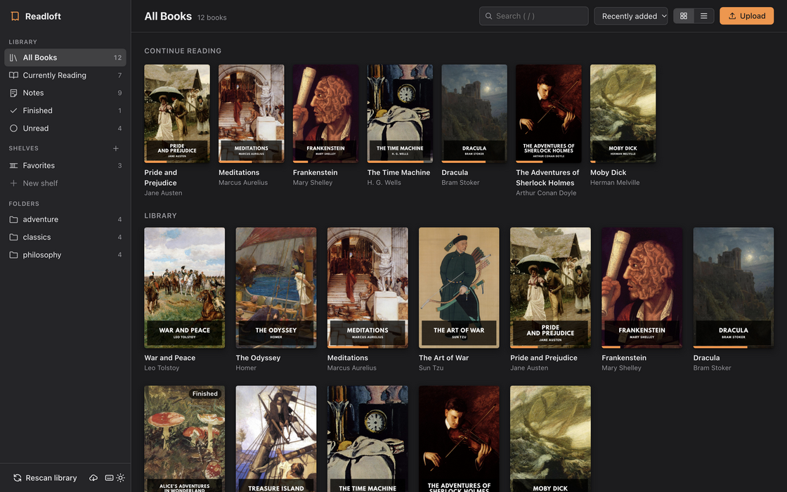
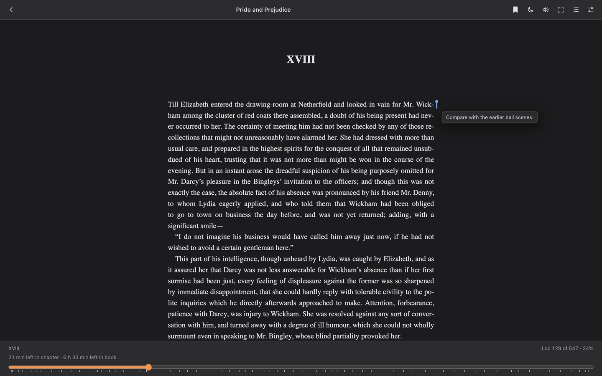
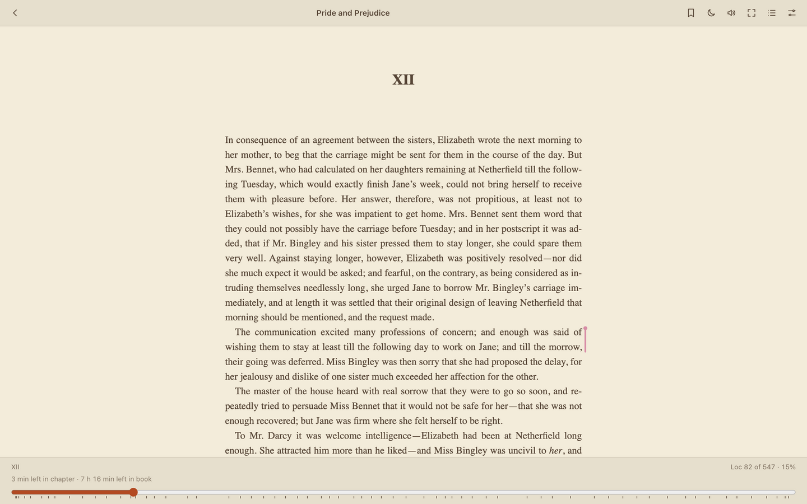
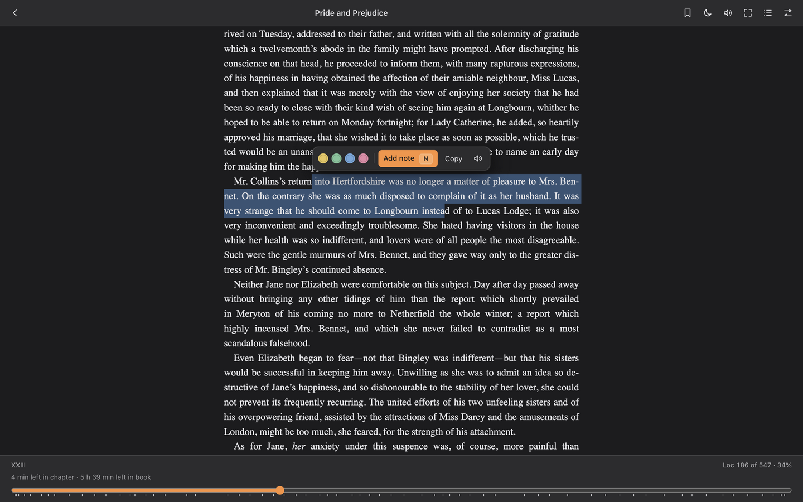
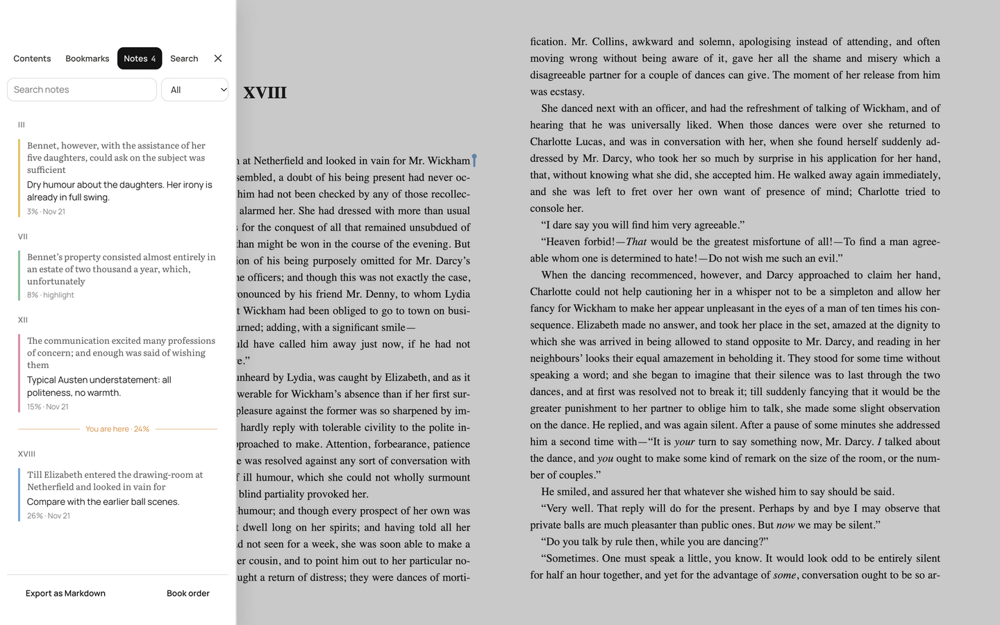
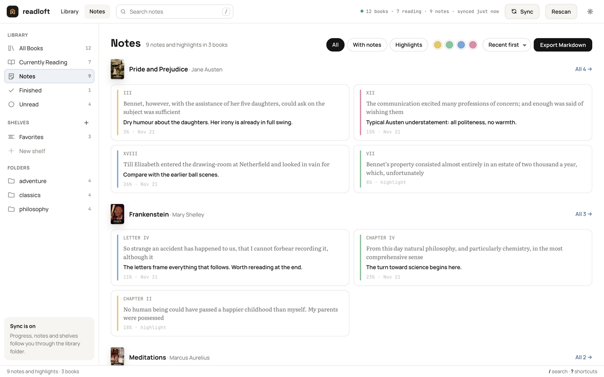
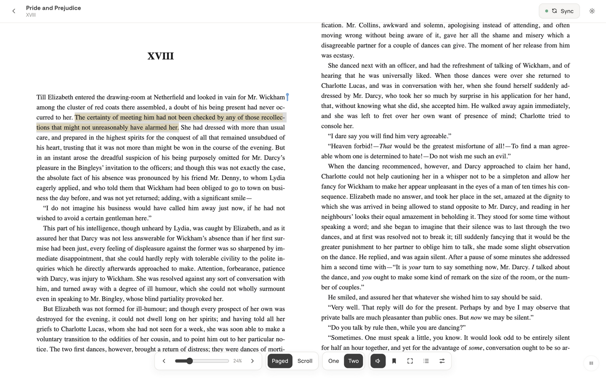
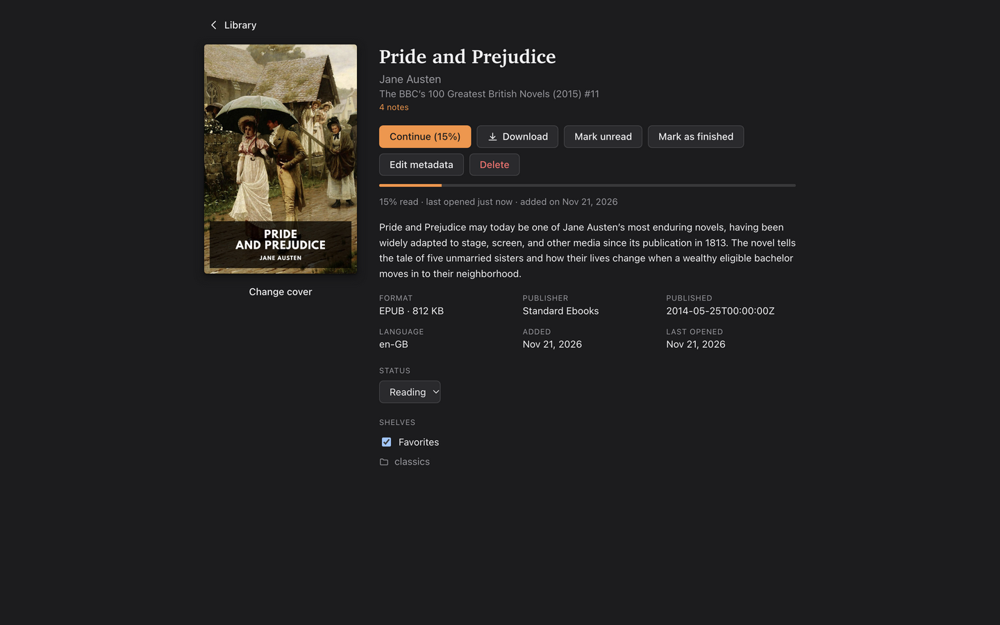
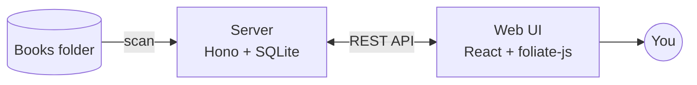

<p align="center">
  
</p>

<h1 align="center">Readloft</h1>

<p align="center">
  Your ebook library, self-hosted. Read anywhere, sync everywhere.
</p>

<p align="center">
  <a href="LICENSE"></a>
  <a href="../../releases"></a>
  
  
  
</p>

<p align="center">
  <a href="#features">Features</a> &middot;
  <a href="#screenshots">Screenshots</a> &middot;
  <a href="#quick-start-docker">Install</a> &middot;
  <a href="#desktop-app">Desktop app</a> &middot;
  <a href="#keyboard-shortcuts">Shortcuts</a> &middot;
  <a href="#sync-between-devices">Sync</a>
</p>

<p align="center">
  
</p>

Point Readloft at a folder of books, open a browser (or the desktop app) and read. It runs on your own machine or server, keeps your reading state in a local SQLite database, and needs no account.

## Features

**Library**
- Scans a folder for EPUB, PDF, MOBI/AZW/AZW3, FB2/FBZ and CBZ and extracts title, authors, series, description and covers.
- Grid and list views, search, sort, and a "Continue reading" row.
- Status filters (reading, finished, unread); mark books finished or unread.
- Drag and drop files into the browser to upload them.
- Edit metadata and set custom covers; edits survive rescans.

**Reader**
- Powered by [foliate-js](https://github.com/johnfactotum/foliate-js). Paginated or scrolled, light/paper/sepia/dark/black themes, fonts, size, line height, margins.
- Table of contents, search in book, bookmarks (rename them in place), progress synced to the server.

**Notes & highlights**
- Select text to highlight it (4 colors) or add a note. Works in EPUB and PDF.
- By default only a quiet margin mark is drawn; turn on "Show highlights in text" in reader settings for a tinted highlight.
- Browse and search them in the reader's Notes tab (grouped by chapter, with a "You are here" marker) and on the library's Notes page. Export as Markdown.

**Read aloud**
- Speaks the book sentence by sentence with your system voices (browser speech synthesis), following along with a highlight.
- Adjustable speed and per-language voice; start from the page or from a selection; skips tables, images and code with a spoken cue.

**Shelves**
- Your own manual shelves (drag and drop books onto them).
- Folder shelves: the subfolders of your library show up automatically as read-only shelves, kept in step with the folder layout on every scan.

**Cross-device sync**
- Point several installs at the same library folder (for example iCloud Drive) and they share progress, status, edited metadata, bookmarks, notes and manual shelves. See [Sync between devices](#sync-between-devices).

**iCloud-aware downloads**
- On macOS, books in iCloud Drive that are not downloaded yet are fetched when you open them, with download progress shown instead of a broken reader.

**Desktop app**
- Installers for macOS, Windows and Linux that bundle the same server. See [Desktop app](#desktop-app).

## Screenshots

<table>
  <tr>
    <td width="50%"><br><sub><b>Reader.</b> A quiet margin mark shows where a note lives; hover to read it.</sub></td>
    <td width="50%"><br><sub><b>Themes.</b> Light, paper, sepia, dark and black, or follow the app.</sub></td>
  </tr>
  <tr>
    <td width="50%"><br><sub><b>Highlights.</b> Select text, pick one of four colors or press <code>N</code> to add a note.</sub></td>
    <td width="50%"><br><sub><b>Notes tab.</b> Notes grouped by chapter, with a marker for where you are.</sub></td>
  </tr>
  <tr>
    <td width="50%"><br><sub><b>Notes page.</b> Every note and highlight across your library; search, filter by color, export.</sub></td>
    <td width="50%"><br><sub><b>Read aloud.</b> Sentence-by-sentence speech with speed and voice controls.</sub></td>
  </tr>
  <tr>
    <td width="50%"><br><sub><b>Book details.</b> Progress, metadata, status and shelves.</sub></td>
    <td width="50%"></td>
  </tr>
</table>

<sub>Screenshots use public-domain books from <a href="https://standardebooks.org">Standard Ebooks</a>.</sub>

## How it works



## Quick start (Docker)

```sh
git clone https://github.com/dfoltynski/readloft.git
cd readloft
docker compose up -d --build
# open http://localhost:8080 — put books in ./books
```

| Env var | Default | Meaning |
| --- | --- | --- |
| `PORT` | `8080` | HTTP port |
| `LIBRARY_DIR` | `./books` (`/books` in Docker) | Folder scanned for books; uploads go to `uploads/` inside it |
| `DATA_DIR` | `./data` (`/data` in Docker) | SQLite database and cover cache |
| `SCAN_INTERVAL_MINUTES` | `30` | Periodic rescan, `0` disables |

> No authentication yet. Don't expose it to the internet directly — put it behind a reverse proxy with auth (Authelia, Authentik, Caddy basic auth…) or on a private network (Tailscale).

## Development

Requires Node 24+ (server runs TypeScript natively, no build step) and git.

```sh
git clone https://github.com/dfoltynski/readloft.git
cd readloft
npm install
npm run setup      # vendors foliate-js into web/public/foliate-js
npm run dev        # API on :8080, web on :5173 (proxies /api)
npm run typecheck
```

### Layout

```
shared/types.ts   API contract + types shared by server and web (start here)
server/           Hono API, node:sqlite, folder scanner, metadata extractors
web/              React + Vite UI; reader wraps <foliate-view>
scripts/          setup helpers
```

## Desktop app

Download the installer for your OS (macOS `.dmg`, Windows `.exe`, Linux `.AppImage` / `.deb`) from the [Releases](../../releases) page. On first launch Readloft asks for your library folder (this can be an iCloud Drive folder); change it later from the app menu. The app runs the same server as the Docker setup, on port 8080 (or a free port if that is taken), so LAN and Tailscale access keep working.

The builds are unsigned, so your OS will warn on first run:

- macOS: right-click the app and choose Open, or run `xattr -dr com.apple.quarantine /Applications/Readloft.app`.
- Windows SmartScreen: click More info, then Run anyway.

To cut a release, push a version tag. GitHub Actions builds all platforms and attaches them to a draft release:

```sh
git tag v0.1.0 && git push origin v0.1.0
```

Locally: `npm run desktop:dev` runs the app against the local build, `npm run desktop:dist` packages for the current OS into `desktop/release/`.

### Rebuilding the desktop app

Run from the repo root. Output goes to `desktop/release/`.

```sh
# once, and after pulling: install deps and vendor foliate-js
npm install
npm run setup

# build the web UI (always, before packaging)
npm run build

# macOS: .dmg for Intel + Apple Silicon
npm run dist -w desktop -- --mac

# macOS: just the .app for this Mac (fast, no .dmg), then install it
npm run dist -w desktop -- --mac dir --arm64      # use --x64 on Intel Macs
ditto desktop/release/mac-arm64/Readloft.app /Applications/Readloft.app

# Linux: AppImage + .deb
npm run dist -w desktop -- --linux

# Windows: NSIS installer .exe
npm run dist -w desktop -- --win

# everything at once
npm run dist -w desktop -- --mac --linux --win
```

Linux and Windows builds are most reliable on their own OS. Cross-building Windows from macOS may need Wine. For all three platforms, pushing a version tag (above) builds them on GitHub Actions.

Quit any running Readloft (including `npm run desktop:dev`) before opening a freshly installed build. The app is single-instance, so a running copy takes over.

## Keyboard shortcuts

Press `?` anywhere for the full cheatsheet (source: `web/src/lib/shortcuts.ts`).

| Where | Keys |
| --- | --- |
| Library | `/` focus search, `U` upload books, `Ctrl/Cmd+A` select all visible books, `Esc` clear selection / leave search, `?` keyboard shortcuts |
| Reading | `←` `→` previous / next page, `Space` / `Shift+Space` next / previous page, `PageUp` `PageDown` previous / next page, `F` fullscreen |
| Navigation | `T` table of contents, `B` toggle bookmark, `Ctrl/Cmd+F` search in book |
| Notes | `N` add note to selection, `A` notes panel, `Esc` close note cards |
| Read aloud | `R` start / pause / resume, `[` `]` previous / next sentence |
| General | `?` this help, `Esc` close panels / stop reading aloud |

## Sync between devices

Point several Readloft installs (e.g. desktop apps on two Macs) at the same library folder, such as an iCloud Drive folder, and they share reading state. Each device keeps its own local database and writes one file, `<library>/.readloft/sync/<deviceId>.json`, holding its full state. It reads the other devices' files every 20 seconds (and after each scan) and merges them record by record, newest change wins.

- **Syncs:** reading progress and position, status, edited metadata, bookmarks, notes and highlights, manual shelves and their contents.
- **Does not sync:** reader display settings, custom covers, folder shelves (derived from the folder layout).
- Records for books a device doesn't have yet are kept and applied once the book shows up.
- **Caveats:** "newest" is decided by each device's clock, so keep clocks roughly right. Linux has no iCloud client; use any folder sync tool (Syncthing, etc.) on the library folder instead.
- `SYNC=0` turns it off; `SYNC_DIR` overrides the location. Status: `GET /api/sync` or the cloud icon in the sidebar.

## Roadmap ideas

- Users & auth, per-user progress
- Online metadata lookup (Open Library / Google Books)
- OPDS feed for other reading apps
- Reading stats and goals
- PWA / offline reading
- PDF tools: merge, split, convert
- Self-hostable out of the box, plus installable desktop apps: buildable for macOS, Windows and Linux

## Contributing

Issues and pull requests are welcome at <https://github.com/dfoltynski/readloft>. See [CONTRIBUTING.md](CONTRIBUTING.md).

## License

Readloft is source-available under the [PolyForm Noncommercial License 1.0.0](LICENSE). It is free for personal and noncommercial use, including modification and forks. Commercial use requires a commercial license; see [COMMERCIAL.md](COMMERCIAL.md). Contributions are welcome under the terms in [CONTRIBUTING.md](CONTRIBUTING.md).

The vendored [foliate-js](https://github.com/johnfactotum/foliate-js) remains MIT-licensed by John Factotum.

The Readloft name and logo (`docs/logo.svg`, `web/public/icon.svg`, `desktop/build/icon.png`) are original artwork made for this project from basic geometric shapes, not derived from any icon set or third-party mark. They are not covered by the code license: forks must use their own name and logo.

Demo books in the screenshots are public-domain editions from [Standard Ebooks](https://standardebooks.org) (CC0).
