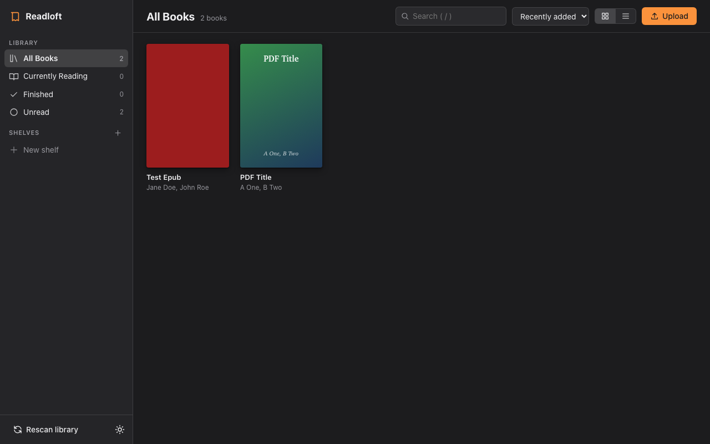
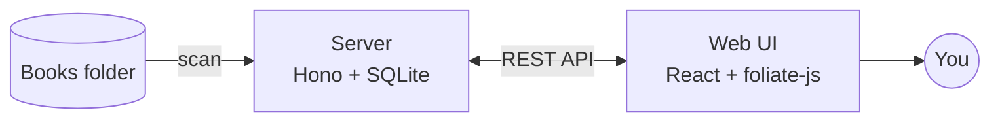

<h1 align="center">Readloft</h1>

<p align="center">
  A self-hosted ebook library and reader. Point it at a folder of books, open a browser, read.
</p>

<p align="center">
  <a href="LICENSE"></a>
  
  
</p>

<p align="center">
  
</p>

## Features

- **Library**: scans a folder for EPUB, PDF, MOBI/AZW/AZW3, FB2/FBZ and CBZ and extracts title, authors, series, description and covers. Grid and list views, search, sort, "continue reading".
- **Shelves**: your own collections, plus status filters (reading, finished, unread).
- **Upload**: drag and drop files into the browser.
- **Reader**: powered by [foliate-js](https://github.com/johnfactotum/foliate-js). Paginated or scrolled, light/sepia/dark themes, fonts, size, line height, table of contents, search, bookmarks (rename them in place), and progress synced to the server.
- **Metadata**: edit metadata and set custom covers; edits survive rescans.

## How it works



## Quick start (Docker)

```sh
git clone https://github.com/dfoltynski/readloft.git
cd readloft
docker compose up -d --build
# open http://localhost:8080 — put books in ./books
```

| Env var | Default | Meaning |
| --- | --- | --- |
| `PORT` | `8080` | HTTP port |
| `LIBRARY_DIR` | `./books` (`/books` in Docker) | Folder scanned for books; uploads go to `uploads/` inside it |
| `DATA_DIR` | `./data` (`/data` in Docker) | SQLite database and cover cache |
| `SCAN_INTERVAL_MINUTES` | `30` | Periodic rescan, `0` disables |

> No authentication yet. Don't expose it to the internet directly — put it behind a reverse proxy with auth (Authelia, Authentik, Caddy basic auth…) or on a private network (Tailscale).

## Development

Requires Node 24+ (server runs TypeScript natively, no build step) and git.

```sh
git clone https://github.com/dfoltynski/readloft.git
cd readloft
npm install
npm run setup      # vendors foliate-js into web/public/foliate-js
npm run dev        # API on :8080, web on :5173 (proxies /api)
npm run typecheck
```

### Layout

```
shared/types.ts   API contract + types shared by server and web (start here)
server/           Hono API, node:sqlite, folder scanner, metadata extractors
web/              React + Vite UI; reader wraps <foliate-view>
scripts/          setup helpers
```

## Roadmap ideas

- Users & auth, per-user progress
- Annotations/highlights and bookmarks
- Online metadata lookup (Open Library / Google Books)
- OPDS feed for other reading apps
- Reading stats and goals
- PWA / offline reading
- PDF tools: merge, split, convert
- Self-hostable out of the box, plus installable desktop apps: buildable for macOS, Windows and Linux

## Contributing

Issues and pull requests are welcome at <https://github.com/dfoltynski/readloft>. See [CONTRIBUTING.md](CONTRIBUTING.md).

## License

Readloft is source-available under the [PolyForm Noncommercial License 1.0.0](LICENSE). It is free for personal and noncommercial use, including modification and forks. Commercial use requires a commercial license; see [COMMERCIAL.md](COMMERCIAL.md). Contributions are welcome under the terms in [CONTRIBUTING.md](CONTRIBUTING.md).

The vendored [foliate-js](https://github.com/johnfactotum/foliate-js) remains MIT-licensed by John Factotum.
